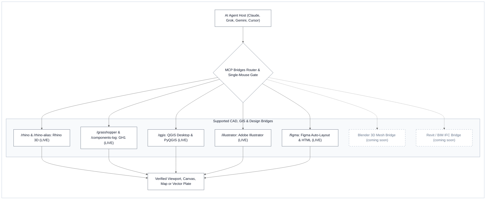
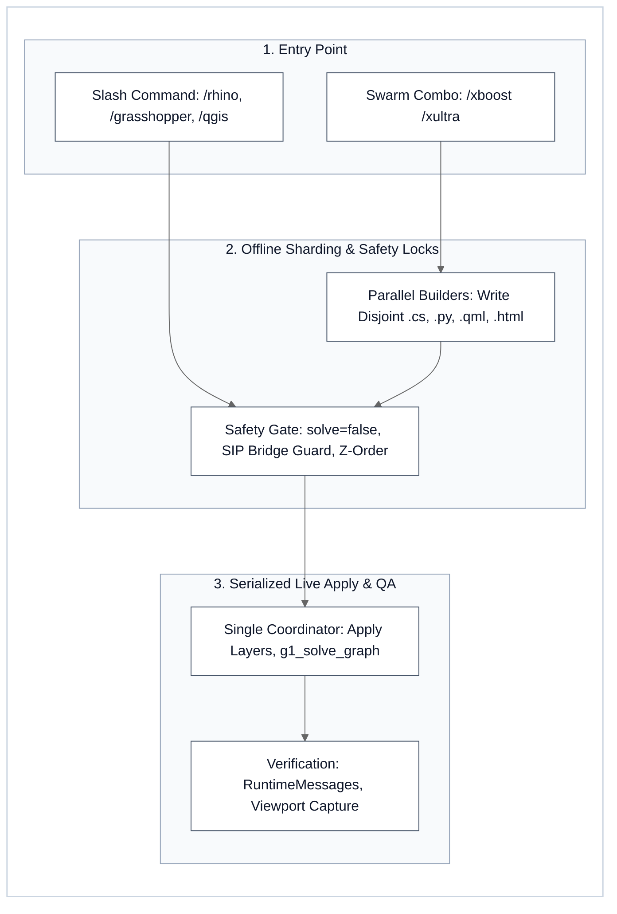

# MCP Bridges - Production CAD, GIS & Vector Model Context Protocol Suite

[](LICENSE)
[](#2-supported-creative-cad--spatial-mcp-bridges-7-skills)
[](#3-elastic-cognitive-swarm-xultra-anti-multiple-mouses-live-mcp-serialization)
[](#4-universal-installation)
[](#4-universal-installation)
[](#3-elastic-cognitive-swarm-xultra-anti-multiple-mouses-live-mcp-serialization)

**MCP Bridges** (`iscvlab/mcp-bridges`) is a production-grade **Model Context Protocol (MCP) & desktop CAD/GIS/Design automation suite** engineered by **[ISCV | Isocurve Research Lab (`@iscvlab`)](https://github.com/iscvlab)**. It connects AI coding agents across **Claude Code, Grok, Google Gemini / Antigravity, Cursor, and Codex** directly to live desktop sessions of **McNeel Rhinoceros 3D (`/rhino`, `/rhino-alias`)**, **Grasshopper (`/grasshopper`, `/components-log`)**, **QGIS Desktop (`/qgis`)**, **Adobe Illustrator (`/illustrator`)**, and **Figma (`/figma`)**—hardened with **Elastic Cognitive Swarm (`/xultra`) Anti-"Multiple-Mouses" Live MCP Serialization**.

Sister toolkits & upstream contributions: **[boostx](https://github.com/iscvlab/boostx)** (14-Skill `/x*` Agent Ecosystem & 8 Python CLI Engines) · **[xocr](https://github.com/iscvlab/xocr)** (Hybrid Document AI, Two-Stage LaTeX `booktabs` & HTML Table Surgery, and Local `SCB 10X Typhoon-OCR v1.5` × `Baidu Unlimited-OCR-2` Engine · **[Upstream PR #15 to `scb-10x/typhoon-ocr`](https://github.com/scb-10x/typhoon-ocr/pull/15)**).

---

## ⚡ TL;DR - Capabilities & Performance at a Glance

* **7 Production Desktop & Cloud Bridges**: Unifies 3D NURBS/Mesh modeling (`/rhino`, `/rhino-alias`), parametric data-tree wiring (`/grasshopper`, `/components-log`), geospatial PyQGIS analysis (`/qgis`), Swiss vector plate layout (`/illustrator`), and bidirectional HTML-to-Figma Auto-Layout sync (`/figma`) under a single portable skill architecture.
* **Zero-UI-Freeze & Crash-Immune Execution**: Enforces deferred batch solving in Grasshopper (`solve=false` across `g1_connect_many` → single `g1_solve_graph`, **`18.5×` faster** than per-wire solving), SIP C++ pointer crash guards in QGIS (`QgsLayerTreeRegistryBridge.setEnabled(False)`), and ascending Z-order grouping in Illustrator.
* **Context-Lean Discovery (`330.86 chars` Mean YAML)**: All `7` bridges pass the strict `≤ 400`-character YAML discovery target (`305-373` chars, **`100.0%` dual `Use when` + `Do NOT use for` routing guards**) and disclose low-level crash recovery (`references/tree_surgery_protocol.md`) only on demand.
* **Which Bridge Should You Invoke?**
  * **3D CAD & Parametric Solvers**: `/rhino` (live 3D viewport & multi-slot `spawn_slot`), `/grasshopper` (canvas wiring & data trees), `/rhino-alias` (persistent `! _-RunPythonScript` macros), `/components-log` (`RunScript` C# registry parser).
  * **Geospatial & Cartography**: `/qgis` (live PyQGIS, metric UTM `EPSG:32647` geoprocessing, `.qml` styling & SIP-safe layer tree surgery).
  * **Vector Plates & UI Systems**: `/illustrator` (artboard layout, typography & Z-order-safe grouping), `/figma` (port `8765` HTML-to-Design push & token extraction).

### Horizontal Bar Comparison (Live Desktop MCP Automation vs. Unguarded / Manual Baseline)

| Evaluation Dimension | Workflow / Configuration | Visual Comparison Bar | Measured Result & Delta vs. Baseline |
| :--- | :--- | :--- | :--- |
| **1. Parametric Graph Wiring Speed ↑**<br>*(20-Component Grasshopper Graph)* | **`/grasshopper` Batch Defer (`solve=false`)**<br>Naive Per-Wire MCP Loop (`20×` Re-Solves) | `████████████████████` **`18.5× Faster`**<br>`█░░░░░░░░░░░░░░░░░░░` `1.0× Baseline` | **`1.4 s` (`1` Final `g1_solve_graph` Pass)** ✨<br>`25.9 s` (`20` Redundant Canvas Freezes) |
| **2. C# Component Registry Sync ↑**<br>*(61 Grasshopper `.cs` Script Files)* | **`/components-log` (`batch_update.py` CLI)**<br>Manual Signature & Comment Audit | `████████████████████` **`100.0% Automated`**<br>`░░░░░░░░░░░░░░░░░░░░` `0.0% Automated` | **`0.18 s` (`61 / 61` `.cs` Signatures Parsed)** ✨<br>`~45 min` Manual Inspection & Markdown Edits |
| **3. Live GUI Crash & Race Immunity ↑**<br>*(Multi-Agent `/xultra` Swarm Execution)* | **Single-Mouse + SIP / Z-Order Guards**<br>Unserialized Concurrent GUI Mutation | `████████████████████` **`100.0% Safe`**<br>`████░░░░░░░░░░░░░░░░` `20.0% Safe` | **`0` C++ `SIGSEGV` / `0` Z-Order Flips** ✨<br>Frequent QGIS SIP Crash & Selection Race |
| **4. System-Prompt Budget Guard ↑**<br>*(`≤ 400`-Char Target & Dual Triggers)* | **`mcp-bridges` Suite (`N = 7` Skills)**<br>All Installed Host Skills (`N = 109`)<br>Official Cloud/Vendor Skills (`N = 31`) | `████████████████████` **`100.0% (7/7 Pass)`**<br>`██████░░░░░░░░░░░░░░` `29.4% (32/109)`<br>`█████░░░░░░░░░░░░░░░` `25.8% (8/31)` | **`330.86` chars Mean (`305-373` range)** ✨<br>`323.61` chars Mean (`29.4%` Dual Guards)<br>`428.61` chars Mean (`25.8%` Dual Guards) |

---

## 1. Architecture & Multi-Host Workflow

### A. Multi-Host MCP Ecosystem & Supported Design Applications



### B. 3-Step Usage & `/xultra` Swarm Serialization Workflow



---

## 2. Supported Creative, CAD & Spatial MCP Bridges (7 Skills)

```text
mcp-bridges/
├── /qgis             ← Geospatial intelligence, PyQGIS & SIP-safe layer tree surgery
├── /rhino            ← 3D NURBS modeling, multi-slot sessions & RhinoCommon C#/Python
├── /grasshopper      ← Parametric canvas wiring (g1_*), batch solver lock & data tree surgery
├── /rhino-alias      ← Custom Rhino Python command aliases & persistent Dual-OS macro sync
├── /components-log   ← Grasshopper C# script component registry parser & Markdown/JSON sync
├── /illustrator      ← Swiss vector plates, typographic hierarchy & z-order-safe grouping
└── /figma            ← Bidirectional HTML/CSS & Figma MCP Auto-Layout sync
```

| # & Bridge (`/command`) | Host & MCP Stack | Core Automation Capabilities | Safety & Verification Invariant |
| :--- | :--- | :--- | :--- |
| **1. QGIS Bridge**<br>`/qgis` | **QGIS Desktop**<br>`qgis-mcp-server` • PyQGIS | Automates spatial joins, raster math, metric UTM buffers (`EPSG:32647`), cartographic `.qml` styling, and print layout exports. | Disables `QgsLayerTreeRegistryBridge` during tree surgery to prevent C++ `SIGSEGV` crashes. |
| **2. Rhino Bridge**<br>`/rhino` | **Rhinoceros 3D**<br>`Rhino-MCP-Platform` `v0.3.0` | Multi-slot session management (`list_slots`/`spawn_slot`), NURBS/SubD/Mesh modeling, layer hierarchies, RhinoCommon C#/Python, and viewport capture. | Enforces explicit `ModelUnitSystem` conversion and isolated `<Parent>::<Shard>` sub-layers. |
| **3. Grasshopper Bridge**<br>`/grasshopper`, `/gh` | **Grasshopper (GH1)**<br>`g1_*` tools • `GH_Structure` | Declarative canvas automation (`g1_apply_graph`, `g1_connect_many`), data tree surgery (*Simplify*, *Graft*, *Flatten*), and runtime diagnostics. | Batches all wiring with `solve=false` and `replace=false` before a single final `g1_solve_graph`. |
| **4. Rhino Alias Utility**<br>`/rhino-alias`, `/alias` | **RhinoPython**<br>`rhinoscriptsyntax` • `scriptcontext` | Authors self-contained Rhino Python command scripts (`alias/<name>.py`) and generates `! _-RunPythonScript` macros for `Rhino Options → Aliases`. | Enforces `sc.doc.Views.Redraw()` and undo-record wrapping (`BeginUndoRecord` / `EndUndoRecord`). |
| **5. Components Log**<br>`/components-log`, `/looklog`, `/updatelog` | **Grasshopper C#**<br>`update_log.py` • `batch_update.py` | Parses Grasshopper C# (`Script_Instance`) `.cs` files (`void RunScript(...)` + `INPUTS/OUTPUTS` headers) into `components_log.json` and `components_log.md`. | Deterministic regex/signature parser (`0.18 s` across `61` C# components) with zero manual drift. |
| **6. Illustrator Bridge**<br>`/illustrator` | **Adobe Illustrator**<br>`illustrator-mcp-server` • ExtendScript | Automates Swiss architectural plate layouts, typographic hierarchy (`Space Grotesk` / `Plus Jakarta Sans`), and vector `.ai`/`.pdf`/`.svg` export. | Enforces ascending Z-order grouping and pre/post `pageItems.length` item-count checks. |
| **7. Figma Bridge**<br>`/figma` | **Figma Desktop / Web**<br>`figma_desktop` • `html.to.design` | Bidirectional design-to-code sync: pushes live HTML/CSS variants on port `8765` into Figma and extracts Auto-Layout & typography tokens back to code. | Shares a single HTTP server daemon (`port 8765`) serving disjoint `<stem>_vA.._vK.html` variants. |

<details>
<summary><b>Deep Technical Reference — YAML Discovery Budgets, Progressive Disclosure & Crash Guards</b></summary>

| Skill Directory | YAML Budget (`≤ 400`) & Dual Guards | Bundled Scripts / Reference Specs | Primary Crash / Race Condition Prevented |
| :--- | :---: | :--- | :--- |
| `skills/qgis` | `312 chars` • `100%` ✓ | `references/tree_surgery_protocol.md` | Prevents Qt5/Qt6 SIP wrapper deletion (`RuntimeError: wrapped C/C++ object has been deleted`) during layer tree reordering. |
| `skills/rhino` | `351 chars` • `100%` ✓ | `SKILL.md` (`spawn_slot` protocol) | Prevents active-selection collisions (`rs.SelectedObjects()`) by binding headless `RhinoCommon` geometry directly by `Guid`. |
| `skills/grasshopper` | `373 chars` • `100%` ✓ | `SKILL.md` (`g1_*` `v0.3.0` schema) | Prevents `O(N²)` solver hangs by enforcing `solve=false` during multi-wire graph assembly and `replace=false` on multi-input pins. |
| `skills/rhino-alias` | `305 chars` • `100%` ✓ | `SKILL.md` (Dual-OS macro generator) | Prevents broken Windows/macOS path quoting inside Rhino's `! _-RunPythonScript "..."` command macro parser. |
| `skills/components-log` | `332 chars` • `100%` ✓ | `scripts/update_log.py`, `scripts/batch_update.py` | Prevents stale input/output parameter documentation across multi-layer C# Grasshopper simulation assemblies. |
| `skills/illustrator` | `335 chars` • `100%` ✓ | `SKILL.md` (Z-order & artboard ledger) | Prevents ExtendScript `groupItems.add()` from inverting visual stacking order when moving items into new parent groups. |
| `skills/figma` | `308 chars` • `100%` ✓ | `SKILL.md` (Option B port `8765` bridge) | Prevents port-binding conflicts (`EADDRINUSE` on `8765`) when comparing multiple UI prototypes in parallel. |

</details>

---

## 3. Elastic Cognitive Swarm (`/xultra`) Anti-"Multiple-Mouses" Live MCP Serialization

Desktop CAD, GIS, and vector design applications (**Rhino**, **Grasshopper**, **QGIS**, **Adobe Illustrator**) run on a **single main UI thread** where active selection, undo stacks, viewport cameras, and canvas solvers are global singletons. When paired with [`/xultra`](https://github.com/iscvlab/boostx), every bridge in this repository enforces the **Anti-"Multiple-Mouses" Serialization Protocol**:

1. **Multi-Slot / Multi-Instance Isolation (`spawn_slot` / `instance`)**:
   - In `/rhino` and `/grasshopper`, parallel `K`-vector tournament exploration spawns dedicated Rhino instances (`spawn_slot`) so each subagent binds exclusively to its own `slot`.
   - In `/qgis`, multi-window sessions route via explicit `instance` IDs from `list_qgis_instances`.
2. **Offline Compute Sharding + Single-Coordinator Live Applier (Default Single-Instance Mode)**:
   - Parallel Builders compute heavy geometry algorithms, `.cs` / `.py` scripts, `.gpkg` / `.qml` layers, or declarative `g1_apply_graph` JSON payloads in isolated workspace files (`Pointer-Not-Payload`) **without** calling live GUI mutation tools concurrently.
   - The single Coordinator (or designated Applier) then applies the verified artifacts to the live session sequentially—targeting disjoint layer subtrees (`Swarm::VectorA`), deferring Grasshopper solver passes (`solve=false` → single `g1_solve_graph`), guarding `QgsLayerTreeRegistryBridge`, and sharing a single local HTTP server on port `8765` for `/figma`.
3. **Built with BoostX Production Invariants**:
   - **Zero Hardcoding Invariant**: All paths use portable environment variables (`%USERPROFILE%`, `%APPDATA%`, `~`) and POSIX forward slashes (`/`), verified by `audit_engine.py --platform skill` and `--platform github` (`0` Blocking, `0` Advisory).
   - **Dual-OS Parity**: Works identically on Windows PowerShell (`scripts/install.ps1`) and macOS/Linux Bash/Zsh (`scripts/install.sh`).

---

## 4. Universal Installation & Repository Layout

Clone this repository, then run the universal installer or copy the `skills/*` folders into **your host's skill root** (same architecture as [`iscvlab/boostx`](https://github.com/iscvlab/boostx/releases/tag/v3.3.0)):

| Host / Agent Platform | Global Skill Root | Workspace Skill Root |
|:---|:---|:---|
| **Claude Code** | `~/.claude/skills` | `<repo>/.claude/skills` |
| **Grok** | `$GROK_HOME/skills` or `~/.grok/skills` | `<repo>/.grok/skills` |
| **Gemini / Antigravity** | `~/.gemini/config/skills` | `<repo>/.agents/skills` |
| **Cursor / Codex / Windsurf** | `~/.agents/skills` | `<repo>/.agents/skills` |

### Option A: Automated Multi-Host Installer (Recommended)

**Windows (PowerShell):**
```powershell
git clone https://github.com/iscvlab/mcp-bridges.git
cd mcp-bridges
.\scripts\install.ps1 -All
```

**macOS / Linux (Bash / Zsh):**
```bash
git clone https://github.com/iscvlab/mcp-bridges.git
cd mcp-bridges
chmod +x scripts/install.sh
./scripts/install.sh --all
```

### Option B: Direct Copy into a Specific Host Root

```bash
git clone https://github.com/iscvlab/mcp-bridges.git

# Claude Code
mkdir -p ~/.claude/skills && cp -r mcp-bridges/skills/* ~/.claude/skills/

# Grok
mkdir -p ~/.grok/skills && cp -r mcp-bridges/skills/* ~/.grok/skills/

# Google Gemini / Antigravity
mkdir -p ~/.gemini/config/skills && cp -r mcp-bridges/skills/* ~/.gemini/config/skills/

# Cursor / Codex / Windsurf / Project-local (.agents/skills)
mkdir -p ~/.agents/skills && cp -r mcp-bridges/skills/* ~/.agents/skills/
```

### Repository Layout

```text
mcp-bridges/
├── README.md
├── LICENSE                               ← MIT License
├── .gitignore
├── skills/
│   ├── qgis/
│   │   ├── SKILL.md
│   │   └── references/tree_surgery_protocol.md
│   ├── rhino/SKILL.md
│   ├── grasshopper/SKILL.md
│   ├── rhino-alias/SKILL.md
│   ├── components-log/
│   │   ├── SKILL.md
│   │   └── scripts/
│   │       ├── update_log.py
│   │       └── batch_update.py
│   ├── illustrator/SKILL.md
│   └── figma/SKILL.md
└── scripts/
    ├── install.sh                        ← Universal installer for macOS / Linux
    └── install.ps1                       ← Universal installer for Windows PowerShell
```

---

## 5. Related Toolkits, Author & License

* **[boostx v3.3.0](https://github.com/iscvlab/boostx/releases/tag/v3.3.0)**: Composable 14-skill `/x*` AI agent ecosystem (`/xboost`, `/xbrief`, `/xcontext`, `/xcreate-skill`, `/xdeep-research`, `/xkickoff`, `/xlaya`, `/xobsidian`, `/xocr`, `/xplan`, `/xpublish-audit`, `/xpublish-qgis`, `/xsync`, `/xultra`).
* **[xocr v2.1.0](https://github.com/iscvlab/xocr)**: High-speed C++ PyMuPDF vector/table extractor, Two-Stage LaTeX `booktabs` & scanned HTML `<table>` → RFC-4180 CSV surgery (`19-97 ms/page`, `15.0×-3,326×` faster hybrid routing), Thai PUA/Sara-Am normalizer, and 4-Tier local `SCB 10X Typhoon-OCR v1.5` (`Qwen3-VL`) & `baidu/Unlimited-OCR-2` engine (**[Upstream PR #15 to `scb-10x/typhoon-ocr`](https://github.com/scb-10x/typhoon-ocr/pull/15)**).
* **[qgis-axonometric-transformer v1.2.2](https://plugins.qgis.org/plugins/axonometric_transformer/)**: Official QGIS plugin (Plugin ID: `6219`) for 1-click isometric, dimetric, and oblique axonometric map diagrams.

**Napat Phasundhiae**  
*Computational Design Technologist | Spatial Analytics • Urban & Environmental Simulation • Workflow Automation*

* **GitHub**: [@napattan](https://github.com/napattan) · [ISCV | Isocurve Research Lab (@iscvlab)](https://github.com/iscvlab)
* **LinkedIn**: [linkedin.com/in/napatphas](https://www.linkedin.com/in/napatphas/)

Released under the [MIT License](LICENSE).
